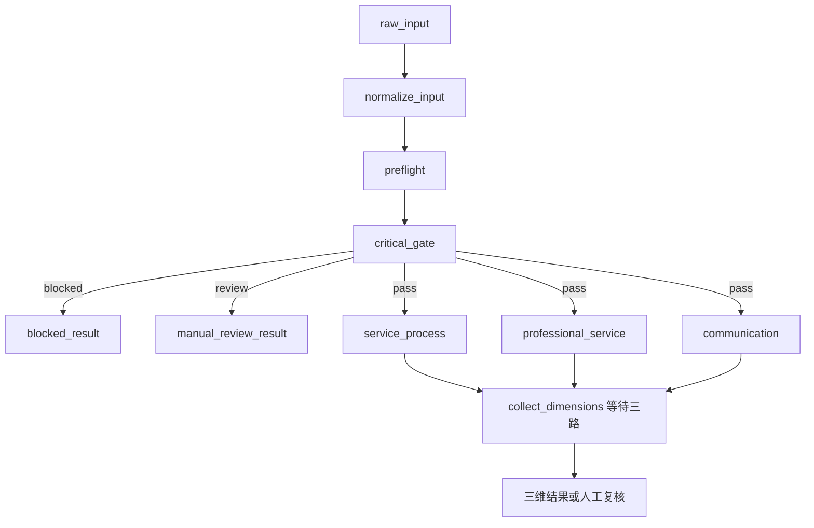

# 三维并行工作流



`build_week3_graph()` 路由返回三个节点名列表发起并发，各分支读取已完成门控的状态，返回自己的字段，不原地改整个State。

```python
builder.add_edge(list(DIMENSIONS), "collect_dimensions")
```

这条列表边等待全部上游。共享轨迹和错误的 `Annotated[list[dict], operator.add]` 将列表拼接；三维分数使用独立字段。轨迹中的并行节点列表次序不代表实际完成先后。

同一步节点并行、共享字段reducer和列表上游边语义，参见 [LangGraph官方指南](https://docs.langchain.com/oss/python/langgraph/use-graph-api) 和 [Graph API概念](https://docs.langchain.com/oss/python/langgraph/graph-api)。

## 分支错误隔离

`make_dimension_node()` 在内部捕获模型、解析、工具错误并输出失败结果，避免异常逃出并行步骤。因此专业服务超时仍保留另外两维，收集节点将整体标为复核。

当前没有checkpointer、持久队列或断电恢复。同步模型接口由图运行时并发调度，一个会话最多同时3个维度请求，批量限流留待后续。

## 验证方式

并行测试使用 `threading.Barrier(3)`，三个假模型都进入后才放行，串行实现会超时；同时验证7条轨迹和唯一汇合节点。

理论上评分阶段接近最慢分支耗时，但真实模型、限流和重试时延未测量，本周不宣称具体提速百分比。
