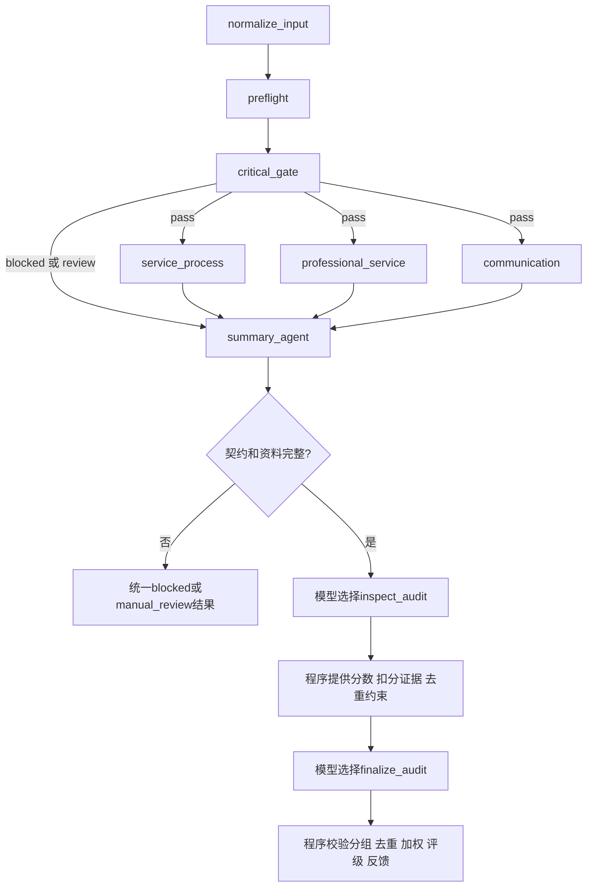

# ReAct汇总Agent与总分计算

原要求的“React范式”按上下文实现为ReAct工具调用循环，不是React前端。



`prepare_audit()`先检查预检、红线、三维结果及子项分数相加一致性；资料不完整时直接输出复核，不浪费汇总模型调用。

`run_summary_agent()`实现有限循环，最多4轮（可配置2～6）。每轮模型选择工具，程序执行后用ToolMessage返回观察，下一轮模型再行动。必须先取得inspect观察，再调用finalize；同一轮中并列提前调用finalize会被拒绝。纯文本“100分”不能形成结果。记录的是工具名、成功/拒绝和分组数，不保存模型内部思考。

这是自定义有界工具循环，采用LangChain的ChatOpenAI、AIMessage和ToolMessage，不依赖弃用的旧Agent入口。概念参考 [LangChain Agents](https://docs.langchain.com/oss/python/langchain/agents)。

## 计算权归程序

`finalize_audit`只接受duplicate_groups和review_reasons，不接受模型提供总分或评级。工具闭包中的原始分无法由模型重写。

```text
total = SP/25 ×20 + PS/50 ×40 + CM/25 ×40
```

`calculate_total()`要求三维完整、原始分合法、权重总和100，使用Decimal计算并四舍五入到两位。原始分记录不变，去重恢复的分数写在adjusted_raw_scores，加权贡献写在weighted_scores。

## 跨维度去重

每个扣分子项有可引用的finding_id，例如professional_service:PS-01；issue_id由内容哈希生成。模型提出同一事实的分组及简短业务依据，程序核验：

- 所有引用必须真实存在，不能重复使用、不能同维度相互合并。
- 必须共享原文消息证据；同一句话本身不证明同一原因。
- 子项组合须在summary.yaml允许的重叠范围内。
- 多业务条款共同形成的专业扣分不能整项恢复，标记mergeable=false；有疑似重复时转复核。
- 对确认同一事实的扣分，仅保留最大加权损失，恢复其余重复项，生成可审阅调整记录。

例如SP-03扣5原始分（总分损失4），PS-01同一问题扣10原始分（总分损失8），保留专业扣8，恢复SP-03。不同原因即使引用同一消息也不能自动合并。语义确认仍依赖汇总模型和人工抽查，程序约束是防误合并边界，不是语义正确性的证明。

原规则只要求不重复扣分，没有指定保留维度，本项目采用“最大加权扣分”作为明确、可测试的第一版策略，记录在配置与此文中，后续可由导师调整业务政策。
